<div align="center">

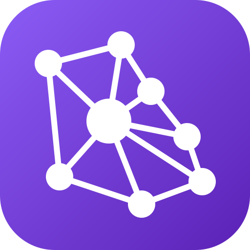

<a href="https://ko-fi.com/taidie"></a>

# Atrium

**Your team's open hall — on your own server.**

Documents, databases, calendar, chat, video meetings, a knowledge graph and AI in one self-hosted
workspace, with apps for Windows and Android. No per-seat fees, and no built-in caps unless you set them.

[Website](https://atrium-five-xi.vercel.app) · [Download](https://github.com/TaiDies/atrium/releases/latest) · [Install guide](docs/INSTALL.md) · [Features & how-to](docs/FEATURES.md) · [License: AGPL-3.0](LICENSE)

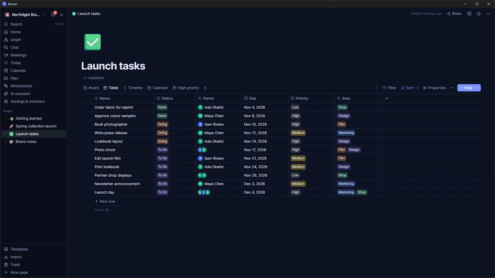

</div>

## Why Atrium

Most team workspaces make you choose: pay per seat and keep your data on someone else's servers, or
stitch together five self-hosted tools. Atrium is one app you run yourself:

- **Everything in one place.** Pages and databases, a calendar that sees every dated card and to-do, chat,
  meetings, whiteboards, and editors for documents, spreadsheets and slides.
- **Yours.** One Docker command, your own Postgres, your own files. Export everything as a .zip at any time.
- **No per-seat fees.** Invite as many people and create as many workspaces as your server can handle;
  the admin panel can set limits if you want them.
- **Works offline.** The Windows and Android apps keep what you've opened and merge edits when you reconnect.
- **AI you control.** Bring your own key (Claude, OpenAI-compatible services, Gemini) or a local model through
  Ollama. Nothing is sent anywhere unless you set a connection up, and the assistant proposes what it makes for
  you to review before anything is added.
- **A memory for Claude.** A built-in MCP server lets Claude use a workspace as its long-term notes.

## See it

<table>
  <tr>
    <td width="50%">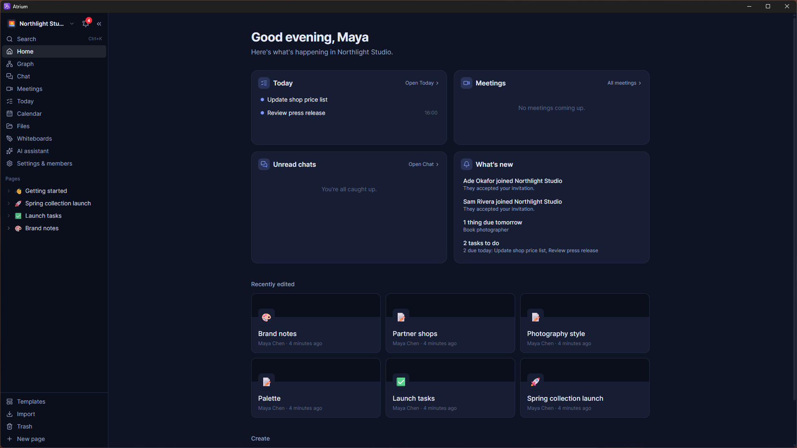<br /><sub>Home: today's tasks, chats and what changed</sub></td>
    <td width="50%">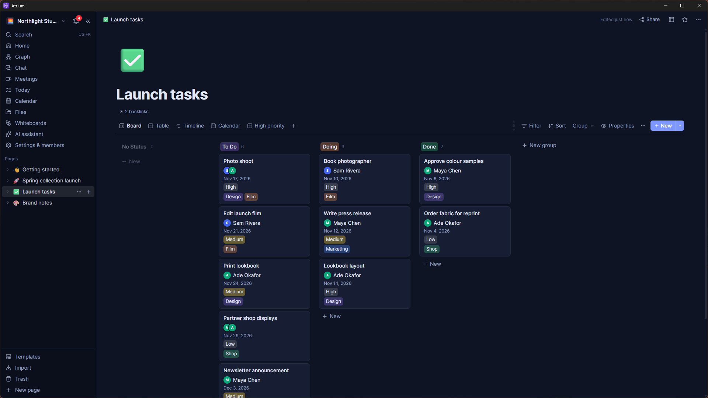<br /><sub>Databases as boards, tables, timelines and calendars</sub></td>
  </tr>
  <tr>
    <td>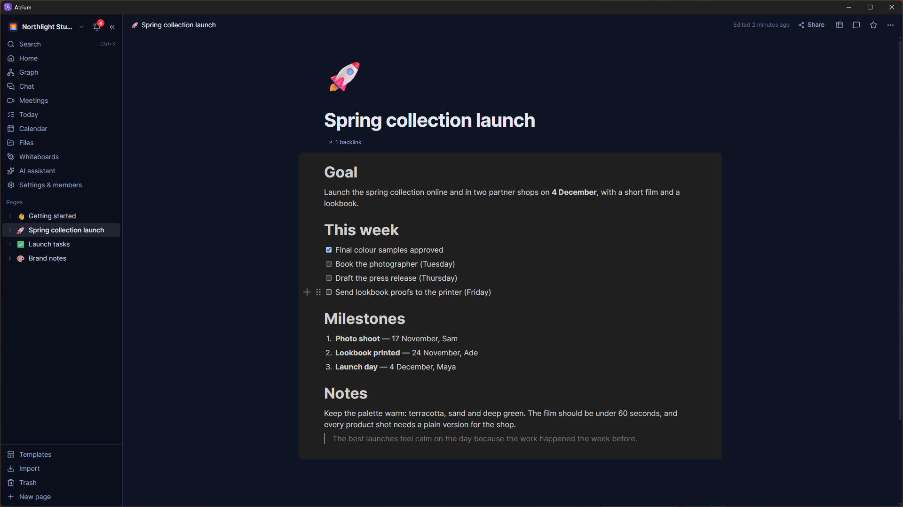<br /><sub>Documents with to-dos, headings and live editing</sub></td>
    <td>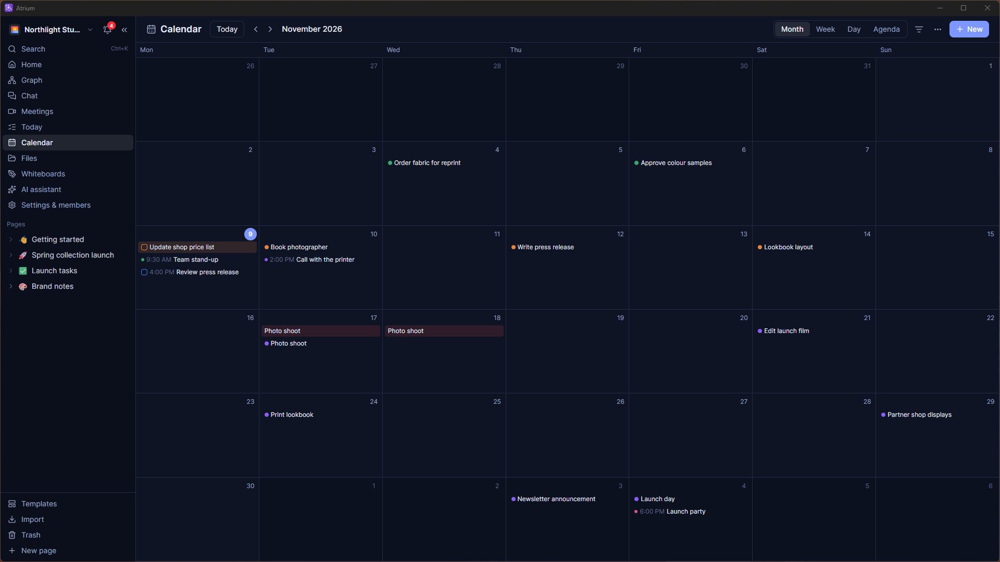<br /><sub>One calendar for events, tasks and dated cards</sub></td>
  </tr>
  <tr>
    <td>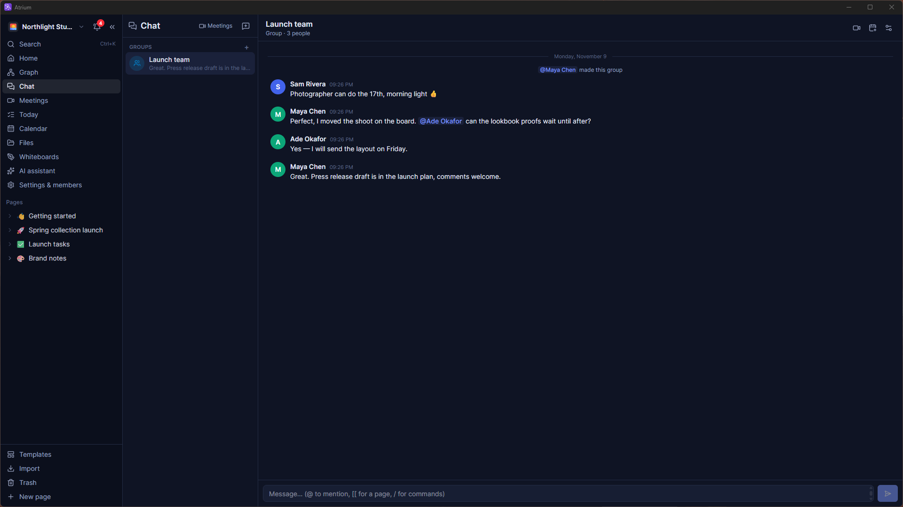<br /><sub>Team chat with mentions and page links</sub></td>
    <td>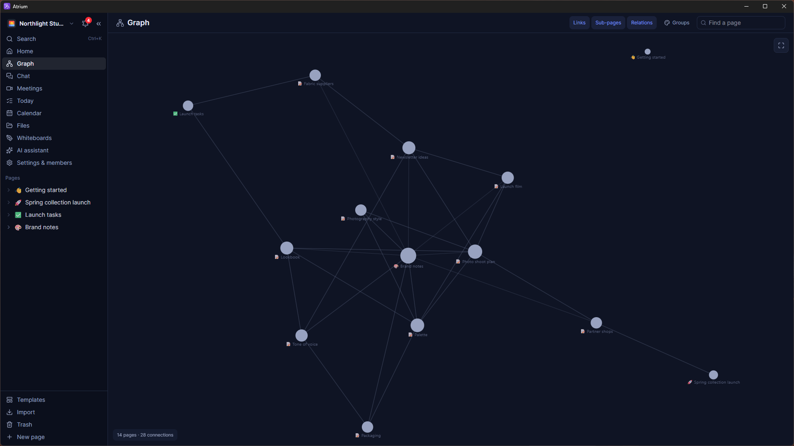<br /><sub>The graph: every page and how it connects</sub></td>
  </tr>
</table>

<p align="center">
  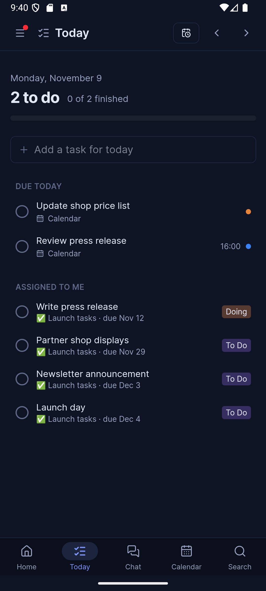
  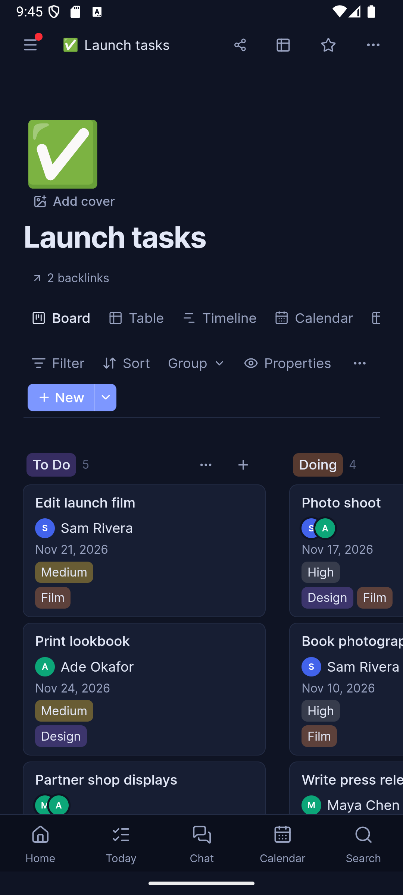
  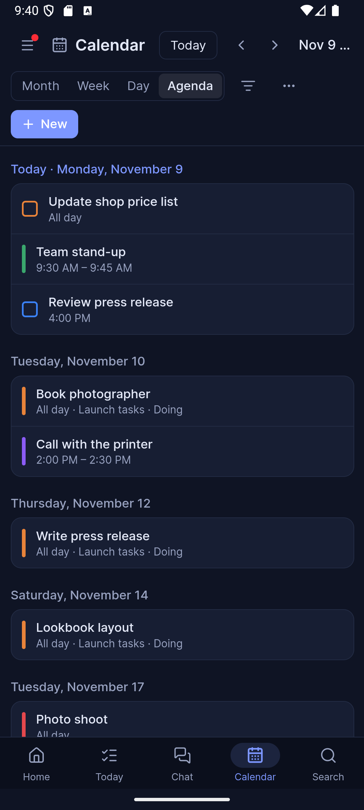
  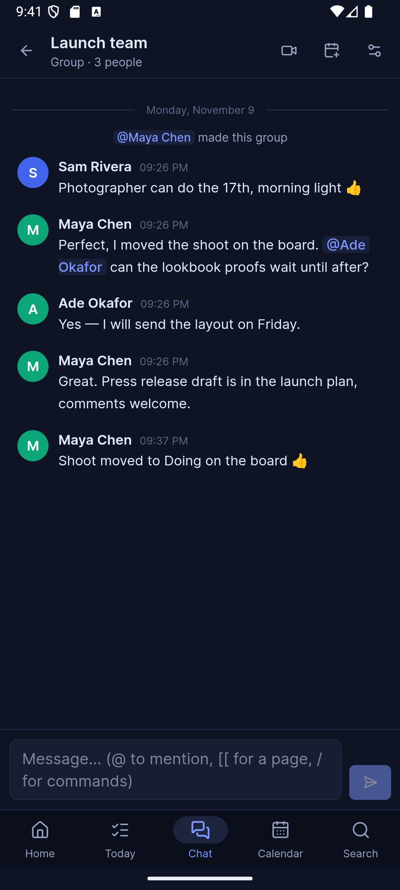
</p>

**Video tour** (1 min 40 s, Windows and Android): [download it](https://github.com/TaiDies/atrium/releases/download/v1.11.8/atrium-demo.mp4) (also [Windows only](https://github.com/TaiDies/atrium/releases/download/v1.11.8/win-tour.mp4) and [Android only](https://github.com/TaiDies/atrium/releases/download/v1.11.8/android-tour.mp4)). More screenshots and GIFs are in [docs/media](docs/media).
All of them show a demo workspace with made-up people.

<details>
<summary>More GIFs</summary>

Moving a card on a board:

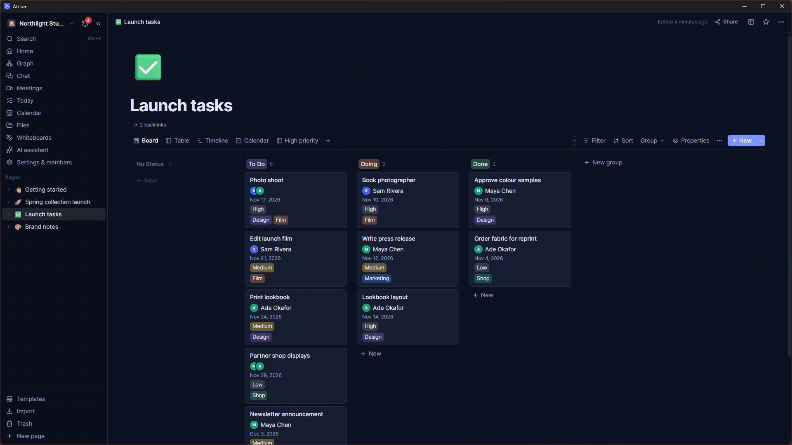

Writing a page with Markdown shortcuts:

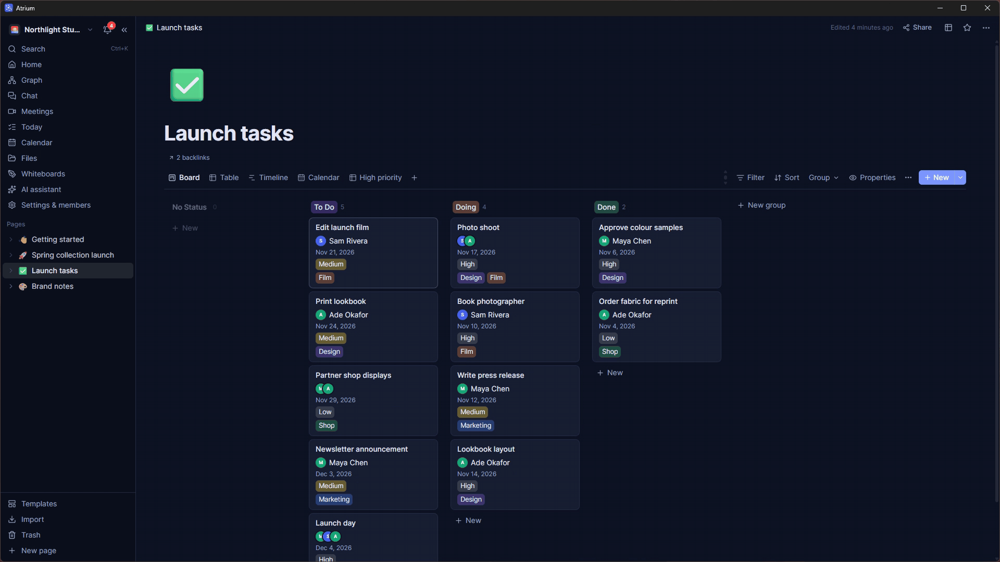

Ticking off a task on Android:

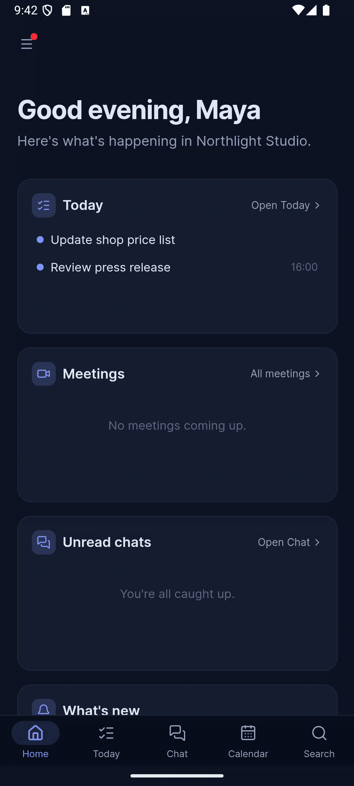

</details>

## Quick start

```bash
git clone https://github.com/TaiDies/atrium.git
cd atrium
cp .env.example .env          # change POSTGRES_PASSWORD
docker compose up -d --build  # then open http://localhost:3000
```

Make the first account (a first workspace is created for you). Then install the
[Windows or Android app](https://github.com/TaiDies/atrium/releases/latest) and connect it to your server,
or just use it in the browser.

Putting it on the internet? Read **[Running a shared or hosted server](docs/INSTALL.md#running-a-shared-or-hosted-server)**
and **[Behind a reverse proxy or tunnel](docs/INSTALL.md#behind-a-reverse-proxy-or-tunnel)** first: set
`PUBLIC_URL`, put HTTPS in front, set `TRUST_PROXY` and `SECURE_COOKIES`, and set up email.

## What's inside

| | |
| --- | --- |
| **Documents** | Block editor with to-dos, callouts, toggles, columns, equations, embeds, comments, page history, templates and live cursors; publish to the web |
| **Databases** | Grid, board, calendar, timeline, gallery, chart, list, feed and forms; relations, rollups, formulas, automations and card templates |
| **Calendar & Today** | Events, tasks, reminders and repeats; every dated card and to-do in one place; plan your day hour by hour; .ics in and out |
| **Chat & meetings** | Private chats, groups and teams; scheduled calls with screen sharing and host controls |
| **Files & Office** | Editors for documents, spreadsheets and presentations, writing on PDFs, whiteboards, full-text search in files |
| **Graph** | Every page and how it connects, with colour groups that mean something |
| **AI** | An assistant that builds documents, databases and plans; AI on selected text; autofill columns; flashcards, quizzes and transcription |
| **Developers** | API tokens, a REST API (guide at `/api/docs`, OpenAPI at `/api/openapi.json`), signed webhooks and an MCP server |
| **Imports** | Notion, Evernote, Trello, Word, Markdown, CSV, and pages (with files) written by any AI chat |
| **Everywhere** | Web, Windows and Android; offline pages; system notifications; English, Spanish, French and Arabic (right-to-left); light and dark themes; one-click updates |

Every feature is explained in **[docs/FEATURES.md](docs/FEATURES.md)**; installing, every setting, backups
and upgrades are in **[docs/INSTALL.md](docs/INSTALL.md)**.

## Honest status

Atrium is young and built by a very small team. What that means in practice:

- **Good for** small and medium teams, families, classes, clubs and personal knowledge bases, on one server.
- **Not yet designed for** very large databases (each is one live document) or big video calls (calls connect
  people directly to each other, which suits a handful of people).
- **Security:** sessions and API tokens can be revoked, access is checked on the server, uploads and outbound
  requests are guarded, and CI runs security tests on every change. It has had several internal hardening
  passes but **no independent audit yet**. Report problems privately: see [SECURITY.md](SECURITY.md).
- **Backups are your job** when self-hosting: the `db` and `data` Docker volumes hold everything.

## Atrium Cloud

Atrium will always be free to host yourself, with every feature. If there is enough interest, a hosted
subscription will follow for people and teams who would rather not run a server: the same app, kept up to date
and backed up for you. **[Leave your email on the website](https://atrium-five-xi.vercel.app/#cloud)** to hear
when it opens.

## Documentation

- [Install and configure](docs/INSTALL.md) · [Features and how-to](docs/FEATURES.md) ·
  [Writing pages with an AI](docs/AI-PAGE-INSTRUCTIONS.md) · [Roadmap](docs/ROADMAP.md) · REST API guide at
  `/api/docs` on your server
- [Architecture, development, building the apps and releases](docs/DEVELOPMENT.md)

## Contributing

Bug reports, translations and pull requests are welcome. Run `npm test` and `npm run test:integration` in
`server/` before opening a pull request (see [docs/DEVELOPMENT.md](docs/DEVELOPMENT.md#development)).
Atrium is licensed under the [AGPL-3.0](LICENSE): you can use and change it freely; if you offer a modified
version as a service, you share your changes.
